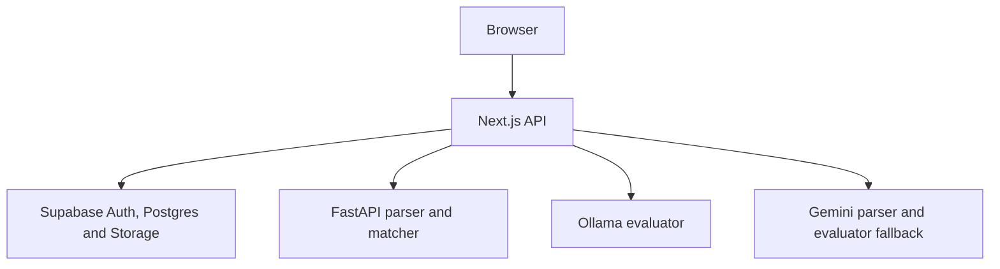

# 6. System architecture and serving



Next.js authenticates each AI request with Supabase. The resume route verifies ownership before reading the stored file. It extracts text, calls FastAPI for structured fields, and saves the profile in Supabase. Candidate analysis sends the existing prompt and a JSON schema to Ollama. It validates the response and its score band before returning it. Gemini handles fallback for resume parsing and candidate analysis and continues to handle role briefs. Successful responses carry `data.model_used`; resume extraction without AI enrichment reports `null`.

FastAPI loads each available artifact once per process. The embeddings endpoint exposes 384-dimensional vectors for integration with Sagnik's matcher and pgvector work. If the matcher is unavailable, the endpoint returns a service error because the shared contract requires vectors from a single compatible embedding space.

FastAPI requests time out after 8 seconds, Ollama requests after 35 seconds, and Gemini requests after 18 seconds. The Next.js routes apply an in-memory limit of 20 requests per user per minute per running limiter instance. Limits reset when serverless instances restart and are independent across replicas. For a demo, run the model services locally or on a separate machine reachable from Next.js. Vercel hosts the Next.js app and does not run the Ollama or FastAPI model processes in this setup.

# 8. Fairness check

The planned audit uses 20 held-out resumes. Each original and its counterfactual variants use the same job description and professional evidence. The variants change a candidate name and specified pronouns or gendered terms. Both providers receive those variants through the authenticated candidate analysis route. The script checks the provider reported by the API before counting a result.

For each provider, compare each variant's score with its original baseline. Report the mean and maximum absolute score change and count verdict flips. The target is a mean change of at most 3 points and zero verdict flips. If a provider misses the target, redact candidate names, pronouns and photo-related text consistently before scoring, then repeat the same comparisons and report both runs.

| Provider | Mean absolute change | Maximum absolute change | Verdict flips |
|---|---:|---:|---:|
| HireLabs evaluator | Pending | Pending | Pending |
| Gemini | Pending | Pending | Pending |

The audit requires the trained evaluator and the authorized held-out cases. An audit result describes sensitivity to these selected edits on this sample. It cannot establish fairness across all candidates or hiring decisions.

## Run the integrated development evaluation

Start the local stack using the project README. Enable `USE_LOCAL_MODELS=true` and `ENABLE_BIAS_CHECK=true` in Next.js and disable placeholders. Provide the private prepared dataset, a current test-user access token in `HIRELABS_ACCESS_TOKEN`, and the trained model files on the evaluation machine. Configure the parser and matcher paths in the shell running Python as well as the model service.

In PowerShell, select the adapters and run the development evaluation from the repository root. Replace the two private input paths and choose a fresh output directory for each audit.

```powershell
$env:HIRELABS_EVAL_ADAPTERS = "spacy_parser,hirelabs_matcher,hirelabs_evaluator,gemini_evaluator"
python -m scripts.eval.run_all --dataset-root "../HireLabs-Data" --split dev --adapter-factory scripts.eval.serving_adapters:configured --fairness-cases "../private/dev-fairness.jsonl" --output "../run-01/results.json" --reports-dir "../run-01/reports"
```

The parser adapter reads original character spans from the installed spaCy model. The matcher ranks the judged candidates using normalized embeddings. Both evaluator adapters call the authenticated candidate API on port 3000 and check the reported provider. Their parsed responses support score and verdict metrics. Raw model JSON syntax cannot be measured from those parsed responses.

Supply 20 distinct dev IDs in the audit manifest. Each candidate's parsedText must match the prepared resume exactly. The audit writes aggregate score changes and verdict flips to `reports/fairness-results.json`. Keep development results separate from Mayukh's final locked-test report.
