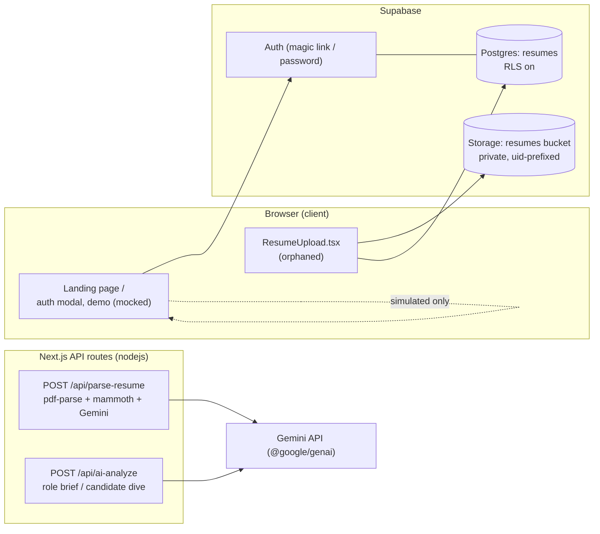
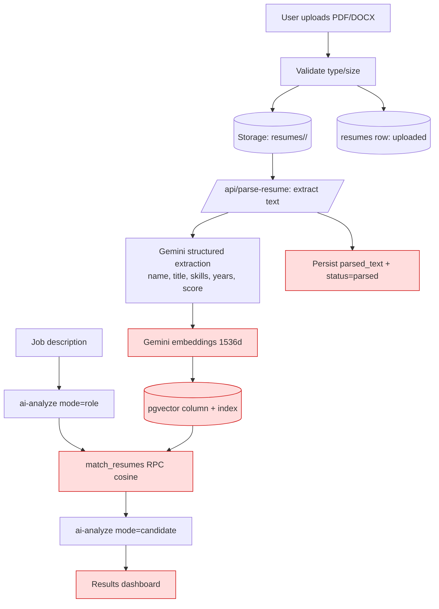

# HireLabs — Phase 1 Architecture Audit

Date: 2026-11-11 · Scope: full repository inspection, verified against source code (not README claims).

---

## 1. Project Overview

HireLabs is an AI resume evaluation and semantic-matching platform: users sign in, upload PDF/DOCX resumes into a private Supabase Storage bucket, resumes are parsed server-side (pdf-parse / mammoth) and enriched with Gemini, and an AI copilot produces role briefs and candidate deep-dives.

Actual product maturity: **early-stage landing page + two working API routes + one minimal upload component**. The semantic matching backend described in the README does not exist in source.

## 2. Existing Technology Stack (verified)

| Layer        | Technology                                                                         | Verified                                                                                             |
| ------------ | ---------------------------------------------------------------------------------- | ---------------------------------------------------------------------------------------------------- |
| Framework    | Next.js 16.3.3 (App Router, Turbopack)                                             | ✅ package.json, build output                                                                        |
| UI           | React 19.2, JSX/TSX mix                                                            | ✅                                                                                                   |
| Language     | TypeScript 7.0.2 + plain JavaScript (mixed)                                        | ✅ tsconfig.json                                                                                     |
| Auth         | Supabase Auth (magic link + password)                                              | ✅ app/page.jsx, app/auth/\*                                                                         |
| DB           | PostgreSQL via Supabase (`public.resumes`)                                         | ✅ migrations 001/002                                                                                |
| Storage      | Supabase Storage bucket `resumes` (private, RLS-scoped)                            | ✅ migration 001                                                                                     |
| AI           | `@google/genai` (Gemini interactions API, JSON-schema responses)                   | ✅ both API routes                                                                                   |
| Parsing      | pdf-parse 2.4.5, mammoth 1.12.2                                                    | ✅ parse-resume route                                                                                |
| **pgvector** | **NOT PRESENT anywhere in the repo**                                               | ❌ verified by search — no `vector` column, no extension, no match RPC, no embedding generation code |
| Styling      | Plain CSS (`index.css`, `style.css`), Tailwind classes referenced without Tailwind | ⚠️                                                                                                   |
| Testing      | **None** — no test runner, no test files                                           | ❌                                                                                                   |
| Lint         | `next lint` script (broken — command removed in Next 16) — repaired in Phase 1     | ✅                                                                                                   |

## 3. Repository Structure

```text
app/
  layout.jsx, page.jsx                  Root layout + landing page (large client component, ~800 lines)
  api/parse-resume/route.js             PDF/DOCX extraction + Gemini enrichment (POST, 60 s)
  api/ai-analyze/route.js               Role brief / candidate deep-dive (POST, 60 s)
  auth/callback/page.jsx                Supabase OAuth/magic-link callback
  auth/update-password/page.jsx         Password update form
  dashboard/resumes/page.tsx            5-line stub that redirects to "/" — real dashboard does not exist
components/
  landing/  (9 components)              Marketing/demo sections
  layout/    Navbar, Footer
  resume/    ResumeUpload.tsx           The only functional app component
  ui/        Badge, Button, Card, CustomCursor, Modal, ScrollReveal, Tabs
lib/
  resume/validation.ts                  File type/size validation (client-side only)
  supabase/client.ts                    Browser Supabase client singleton
supabase/migrations/                    001_create_resumes.sql, 002_resume_parsing.sql
legacy/ + root *.js/html/css files      Original static prototype + one-off codemod scripts (retained)
docs/project-analysis/                  This audit (created in Phase 1)
```

## 4. Frontend Architecture

- Single-page structure: everything lives on `/` (landing page with auth modal inline).
- `app/dashboard/resumes/page.tsx` is a stub that redirects home — **the dashboard page advertised in the README is missing**.
- `ResumeUpload.tsx` is functional (validation → storage upload → DB insert with rollback) but **is not rendered anywhere** — no route imports it; it is orphaned code.
- `InteractiveDemo.jsx` is a mocked front-end demo: it _simulates_ resume parsing and match scores locally (`setTimeout` + canned data) — it does **not** call `/api/parse-resume` or `/api/ai-analyze` despite those endpoints existing and expecting different request shapes (`multipart/form-data` vs JSON).
- Repeated `import React from 'react'` is unnecessary with the `react-jsx` transform (lint warnings, LOW).
- Heavy client-side rendering: the entire landing page is `'use client'` including static marketing sections — no RSC benefit (MEDIUM).
- No route guard for authenticated areas (there are no authenticated areas yet).

## 5. Backend Architecture

Two API routes, both `runtime = 'nodejs'`, `maxDuration = 60`:

| Route                    | Status      | Notes                                                                                                                                                                                                                    |
| ------------------------ | ----------- | ------------------------------------------------------------------------------------------------------------------------------------------------------------------------------------------------------------------------ |
| `POST /api/parse-resume` | IMPLEMENTED | Size/type checks, PDF via pdf-parse v2, DOCX via mammoth, text cleaning, optional Gemini structured extraction with graceful degradation to defaults. Fixed in Phase 1: `eval('require("pdf-parse")')` → dynamic import. |
| `POST /api/ai-analyze`   | IMPLEMENTED | `mode: candidate \| role`, JSON-schema-constrained Gemini output, input clipping (10k–30k chars). Fixed in Phase 1: removed dead `API_URL`/`extractOutputText`.                                                          |

Missing backend (confirmed absent):

- No resume **delete** endpoint or DB-row lifecycle management (`processing_status` is never advanced past `uploaded`).
- No job-description persistence, no match endpoint, no candidates/jobs tables.
- No rate limiting or CSRF handling on either API route.
- No server-side Supabase client and **no auth verification inside API routes** — `parse-resume` accepts any file from anyone; nothing ties a parsed resume to the uploading user server-side.
- No shared response/error envelope; each route hand-rolls `{ error }` JSON (acceptable at this scale, standardise before Phase 2).

## 6. Database Architecture

Migration 001 — `public.resumes` + private `resumes` storage bucket:

- RLS enabled on the table with owner-scoped SELECT/INSERT/UPDATE/DELETE policies ✅
- Storage policies restrict objects to `<auth.uid()>/...` prefixes ✅ (no public read)
- **Storage UPDATE policy is missing** — clients cannot overwrite/update uploaded files (fine for immutable uploads; document it).

Migration 002 — adds parsed columns (`parsed_text`, `extracted_skills`, `candidate_name`, `candidate_title`, `years_experience`, `profile_completeness`, `parser_error`) and a `(user_id, created_at desc)` index ✅

Gaps:

- **No pgvector extension, no `embedding vector(1536)` column, no ivfflat/hnsw index, no `match_resumes` RPC** — README §Security ("Gemini Embedding 2 … 1536 dimensions") and the layout metadata ("pgvector") describe infrastructure that does not exist. Verified by exhaustive source search.
- No `job_descriptions`, `matches`, `profiles`, or audit-log tables.
- Nothing in the app ever writes the parsed columns of migration 002 — parse results go to the browser only; the DB row stays at `processing_status = 'uploaded'`.

## 7. AI/ML Pipeline — Step Classification

| Step                       | Status                       | Evidence                                                                  |
| -------------------------- | ---------------------------- | ------------------------------------------------------------------------- |
| Resume upload → Storage    | **IMPLEMENTED**              | `ResumeUpload.tsx` (unreachable from UI)                                  |
| Resume row in Postgres     | **IMPLEMENTED**              | insert with storage rollback                                              |
| Resume parsing (PDF/DOCX)  | **IMPLEMENTED** (API exists) | `/api/parse-resume` — but never called by any UI                          |
| Structured extraction      | **IMPLEMENTED**              | Gemini JSON-schema extraction, degraded defaults when key missing         |
| Persisting parsed data     | **MISSING**                  | migration 002 columns are never written                                   |
| Embedding generation       | **MISSING**                  | no code, no pgvector, no model config                                     |
| Job description processing | **PARTIALLY**                | `ai-analyze` mode=`role` returns a brief; nothing stored                  |
| Semantic matching          | **MISSING**                  | no RPC/vector search; `InteractiveDemo.jsx` fabricates scores client-side |
| Candidate evaluation       | **IMPLEMENTED**              | `ai-analyze` mode=`candidate`                                             |
| Results dashboard          | **MISSING**                  | `dashboard/resumes` redirects away                                        |

**Disconnected modules:** `InteractiveDemo.jsx` (mocked) vs the two real endpoints (unconsumed) vs `ResumeUpload.tsx` (orphaned). The three never meet.

## 8. Existing Feature Analysis

Working today: landing page with inline auth modal (magic link + password), Supabase callback, password update, resume upload component (if wired), resume parsing API, AI role brief / candidate deep-dive APIs, DB schema with sound RLS.

## 9. Missing Feature Analysis (Phases 2–6 territory)

Real dashboard, resume list/delete UI, job description CRUD, embeddings + pgvector schema/RPC, matching engine, candidate ranking UI, bulk ingestion/queue, audit logs, tests, rate limiting.

## 10. Technical Debt

1. Mixed JS/TS with `"strict": false`, weak typing (`as any` cast on the Supabase insert).
2. `three` + `@types/three` + heavy `VectorField.jsx` animation shipped as landing-page deps — consider lazy loading (MEDIUM).
3. One-off codemod scripts (`make_route.js`, `replace_card.js`, …) polluting the repo root — candidates for archiving under `legacy/`.
4. Stray root `package-lock.json` one directory above the real one causes the Turbopack workspace-root warning.
5. No test infrastructure whatsoever.
6. ~30 lint warnings (unused imports) — cosmetic, scheduled for cleanup.

## 11. Security Observations

Good: RLS everywhere, private bucket, uid-prefixed storage paths, anon key only in browser env vars, Gemini key referenced server-side only, structured outputs constrain AI responses.

Issues:

- **HIGH:** `/api/parse-resume` and `/api/ai-analyze` perform no authentication check — unauthenticated callers can burn the Gemini quota. Mitigation (Phase 2): verify the Supabase JWT server-side (Authorization header → `auth.getUser()`).
- **MEDIUM:** no rate limiting on AI-consuming endpoints.
- **LOW:** `.env.example` documents a placeholder `GEMINI_MODEL`; README mentions `gemini-3.7-flash` while the code default is `gemini-3.5-flash` — align docs.
- No secret committed anywhere (checked) ✅.

## 12. Performance Observations

- `parse-resume` caps text at 50k chars, Gemini input at 10k — bounded, fine.
- 60 s `maxDuration` on both routes is generous for the workload; fine on Vercel hobby/pro limits.
- Sequential per-file upload loop in `ResumeUpload.tsx` (OK for small batches).
- Client bundles include Three.js for the hero animation; code-splitting recommended.

## 13. Priority-Wise Issue Register

| ID   | Pri            | Issue                                                                                     | File                             | Fix                                                                            | Depends on |
| ---- | -------------- | ----------------------------------------------------------------------------------------- | -------------------------------- | ------------------------------------------------------------------------------ | ---------- |
| I-1  | CRITICAL→fixed | `eval('require("pdf-parse")')` — brittle, bundler-unsafe, hides the real failure cause    | `app/api/parse-resume/route.js`  | Replaced with `await import('pdf-parse')` in Phase 1 ✅                        | —          |
| I-2  | HIGH           | `npm run lint` ran `next lint`, a command removed in Next 16 → guaranteed exit 1          | `package.json`                   | eslint 9 + flat config; script now `eslint .` ✅                               | —          |
| I-3  | HIGH           | No lint config existed at all                                                             | repo root                        | `eslint.config.mjs` created ✅                                                 | I-2        |
| I-4  | HIGH           | API routes accept unauthenticated requests (quota abuse / cost)                           | both routes                      | Add server-side Supabase auth check                                            | Phase 2    |
| I-5  | HIGH           | No semantic matching backend though marketed (pgvector absent)                            | supabase/, lib/                  | Migration 003: pgvector + embeddings + RPC                                     | Phase 3    |
| I-6  | HIGH           | Parsed resume data never persisted; `processing_status` stuck at `uploaded`               | routes/db                        | Persist parse output server-side                                               | Phase 2    |
| I-7  | MEDIUM         | `dashboard/resumes` is a stub; dashboard doesn't exist                                    | `app/dashboard/resumes/page.tsx` | Build real dashboard                                                           | Phase 2    |
| I-8  | MEDIUM         | `ResumeUpload.tsx` orphaned — never rendered                                              | components/resume                | Wire into dashboard                                                            | Phase 2    |
| I-9  | MEDIUM         | `InteractiveDemo.jsx` fabricates scores client-side; misleads users about real capability | components/landing               | Wire to real APIs or label as simulation                                       | Phase 2    |
| I-10 | MEDIUM         | typescript-eslint incompatible with TS 7.0.2                                              | eslint.config.mjs                | Adopted JS-only lint + `typecheck` script; revisit when TS support ships       | —          |
| I-11 | MEDIUM         | Stray duplicate `package-lock.json` at parent dir → workspace-root warning                | parent directory                 | Remove parent lockfile or set `turbopack.root` (needs approval — outside repo) | —          |
| I-12 | LOW            | ~30 unused-import lint warnings                                                           | various                          | Cosmetic cleanup                                                               | Phase 2    |
| I-13 | LOW            | README/code model-default mismatch (`gemini-3.7-flash` vs `3.5-flash`)                    | README, routes                   | Align one way                                                                  | —          |
| I-14 | LOW            | Missing storage UPDATE policy (by design for immutable uploads)                           | migration 001                    | Document or add policy                                                         | —          |

## 14. Recommended Improvements

Already done in Phase 1 (§foundational fixes in final report). Next, in order:

1. Phase 2: server-side auth guard + shared API response helper; wire `ResumeUpload` into a real dashboard; persist parse results (advancing `processing_status`); replace the fake demo with real API calls or an explicit "simulation" label.
2. Phase 3: `003_match_schema.sql` — `create extension vector`, `embedding vector(1536)`, ivfflat index, `match_resumes(authUid, queryEmbedding, k)` RPC enforcing `auth.uid()`; Gemini embedding generation service (`text-embedding-004` / equivalent, 1536 dims).
3. Phase 4: matching + ranking UI; Phase 5: evaluation/analytics; Phase 6: hardening (rate limits, audit logs, Vitest suites).

## 15. Architecture Diagram



Dotted path = currently simulated, not wired to the backend.

## 16. Complete AI Pipeline Diagram (target vs actual)



Red = missing or disconnected today.

## 17. Phase 2 Prerequisites

1. Decide auth transport for API routes (cookie/session header) and implement the server-side guard (I-4).
2. Stand up a real `/dashboard` route that renders `ResumeUpload` and a resume list backed by the RLS'd `resumes` table.
3. Write parsed output back to Postgres and advance `processing_status` (`uploaded → parsed → embedded → failed`).
4. Choose and document the embedding model/dimension pair before migration 003 (README promises 1536).
5. Introduce Vitest (repo has zero tests) with at least: `validation.ts`, text cleaner, `parseJson` of ai-analyze.
6. Resolve the stray parent `package-lock.json` (I-11) to silence the Turbopack root warning.
